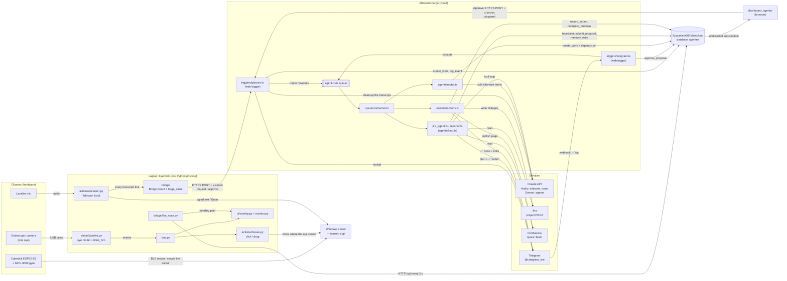
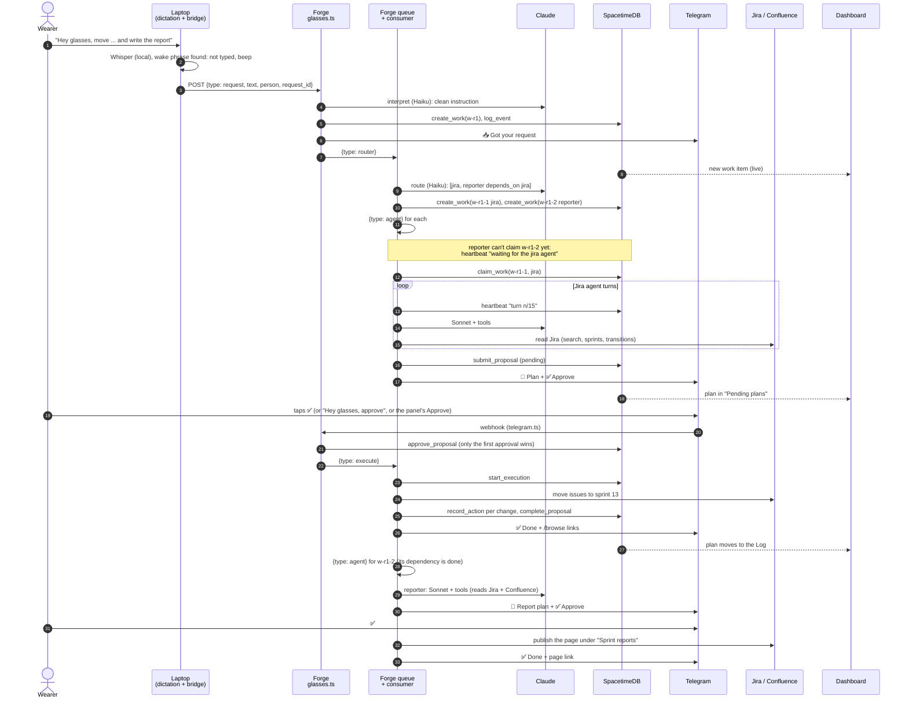

# CaleGlasss

Smart Glasses for Cal Hacks 13.0. **EyeClick**: a Python program reads an endoscopic camera pointed at one eye, measures how long each eye closure lasts, and turns it into a left or right click. The cursor is moved by **Calestick**: an ESP32-S3 with an MPU-6050 gyroscope on the glasses that pairs with the computer as a Bluetooth (BLE) mouse. Turn your head and the cursor follows where you look (`firmware/Calemouse`). The two parts don't talk to each other: the ESP32 moves the cursor, EyeClick clicks.

| Eye closed | Result |
|---|---|
| less than 0.4 s | Natural blink, ignored |
| 0.5 – 1.2 s | Left click |
| 1.2 – 3.0 s | Right click |
| more than 3.0 s | **Drag**: the left button goes down where the cursor was when you closed your eye; turn your head to move; **open your eye to drop** |

The click fires **when the eye opens**, at the position the cursor had **when it closed**. A beep plays at 0.5 s, a different one at 1.2 s, and a rising two-tone at 3.0 s when the drag starts (falling two-tone when you drop). If the camera loses the eye mid-drag, or you pause or recalibrate, the button is released, so it never stays stuck down.

**Double click:** two left clicks within 1.5 s and 40 px of each other. The second one sends a real double click where the first one was.

**Drag:** press **Drag** on the dashboard (or **F10**) → left blink to grab → turn your head to move → left blink to drop. Pressing Drag/F10 again, a right click, or Pause cancels it and releases the button. The dashboard and floating indicator show the drag state the whole time.

**Dictation (lavalier mic):** look at the **mic** button on the floating indicator and blink (left click), or press **F11**. After a high beep, speak; it stops by itself after 1.5 s of silence (or blink on mic again). After a low beep the text is typed wherever the text cursor was. Clicking the indicator doesn't take focus away from that app. Speech is transcribed on the laptop with faster-whisper (no internet after the first run, nothing is logged). Settings are in `config.py`: `DICTATION_LANGUAGE` (`"en"`, `"es"`, or `None` to auto-detect), `DICTATION_MODEL` (`tiny`/`base`/`small`), `DICTATION_DEVICE` (`None` = Windows default mic, or part of its name such as `"USBAudio"`). The first run downloads the model (~145 MB); it then loads in the background when the app starts.

**Automatic dictation (`DICTATION_AUTO = True`, on by default):** no button needed. Blink into a text box in any app (browser field, Word, Notepad, chat) and just start talking. EyeClick checks with Windows UI Automation whether the focused element is an editable text box, and listens for *your* voice: the lavalier hears its wearer much louder than people nearby (`DICTATION_AUTO_RMS`). A short clip from just before you started is kept, so the first word isn't cut off. Because it could mistake a conversation for dictation, auto-dictated text is **not typed right away**: it appears under the floating indicator with a chime, then **left blink = type it**, **right blink = discard**, or do nothing for 10 s to discard. That confirming blink doesn't click, so the text cursor stays where it was. It doesn't start while paused or when EyeClick's own windows have focus. The mic button / F11 still work and type directly.

**Voice commands:** if everything you say is just **"enter"** it presses Enter, and just **"delete"** deletes the previous word (Ctrl+Backspace), in both manual and automatic dictation (no confirm blink needed). Inside a sentence the words are typed normally.

On top of EyeClick sits the **agent team**: the wearer asks for something by voice, a Forge app routes it to Claude agents (Jira, reporter), and the progress shows up live on the glasses' overlay and on a web dashboard. See [Agent team](#agent-team-voice--forge--agents).

## Setup

Python 3.11, Windows or Mac.

```bash
python -m venv .venv
.venv\Scripts\activate          # Windows
source .venv/bin/activate       # Mac
pip install -r requirements.txt
python -m pytest
```

On Mac, give **Camera**, **Accessibility** and **Input Monitoring** permissions to the terminal or VS Code. Without them the cursor doesn't move and there's no error.

## ESP32 gyroscope mouse (Calestick)

The sketch is `firmware/Calemouse/Calemouse/Calemouse.ino` (Visual Micro solution: `firmware/Calemouse/Calemouse.slnx`; the Arduino IDE also opens the `.ino` directly). It only moves the cursor. All clicks come from EyeClick.

**Hardware:** ESP32-S3 + MPU-6050/6500/9250 (e.g. the blue MPU-92.65 board) over I²C: SDA → GPIO 8, SCL → GPIO 9, VCC → 3.3 V, GND → GND (address 0x68).

**Mounting:** the board stands upright with its pins on top (Y axis up), the X arrow along the temple (forward/back) and the chip facing out to the side. Turning your head left/right moves the cursor left/right; nodding moves it up/down. If a direction is backwards, flip **Invertir X** / **Invertir Y** on the settings page and press **Guardar**.

**Flash it once:**
1. Arduino IDE → Boards Manager: install **esp32 by Espressif**. Library Manager: install **HijelHID_BLEMouse** (`Wire`, `WiFi`, `WebServer` and `Preferences` come with the ESP32 core).
2. Board: **ESP32S3 Dev Module**. Select the ESP32's COM port and Upload.
3. Optional: Serial Monitor at 115200 should print `WHO_AM_I=` followed by `0x68` (MPU-6050), `0x70` (MPU-6500) or `0x71`/`0x73` (MPU-9250/9265 boards); `0xFF` or `0x00` means the sensor isn't answering, so check the wiring. It then prints which network it joined and its address.

**Every time you use it:**
1. Power the ESP32 and **keep your head still for ~1 s**. It calibrates the gyro and takes that position as "center".
2. The first time only: pair **Calestick** in the computer's Bluetooth settings. After that it reconnects on its own.
3. Look at what you want to click. The cursor moves by the same amount your head turns (**Sensibilidad**, default 40 px per degree), so a small turn gives a small, precise move. When the cursor stops at a screen edge and your head keeps turning, the "center" shifts with you, the same as lifting a mouse and putting it back down.
4. On Windows, turn off **Settings → Bluetooth & devices → Mouse → Additional mouse settings → Pointer Options → Enhance pointer precision**. Otherwise Windows adds acceleration and the cursor stops lining up with your head.

**Modes:** *Modo apuntar* (default) maps how far you turn your head to cursor distance. Turn it off on the settings page to get the old joystick mode, where the tilt angle sets the cursor speed (the dead zone, range, max speed and curve sliders only apply to that mode). *Filtro de temblor* hides small shaking while you hold your head still; raise it if the cursor jitters, lower it if slow, fine moves feel sticky.

**Wi-Fi (optional):** copy `firmware/Calemouse/Calemouse/wifi_secrets.example.h` to `wifi_secrets.h` in the same folder and put your network name and password in it (git ignores that file). On power-on the ESP32 tries that network for 10 s. If it can't connect, or there's no `wifi_secrets.h`, it creates its own network **Calestick-AP** (password `12345678`). The mouse works from the first second either way; Wi-Fi is only for the settings page. Serial Monitor (115200) prints which network it joined and its address.

**Recalibrate by shaking your head (no website, no Wi-Fi switching):** shake your head left-right quickly for ~2–3 s (8 fast reversals). The cursor freezes; **hold still** for a moment and the ESP32 recalibrates the gyro and recenters, the same as the **Calibrar giro** button. The dashboard and floating indicator show **GYRO: hold still...** and then **gyro calibrated ✓** with a beep (blinks don't click meanwhile). The ESP32 can't send text to the laptop (it's only a Bluetooth mouse), so it signals with the cursor itself: a tiny down-and-exactly-back blip at the start and a right-and-back blip at the end, which EyeClick recognizes (`eyeclick/actions/gyro_watch.py`; EyeClick's own cursor jumps are ignored). If your board has an RGB LED it also turns yellow while calibrating and green when done. If you don't hold still within 8 s it gives up and EyeClick says *gyro not calibrated*.

**Gyro drift:** a gyroscope reads a small turning speed (bias) even when still, and it changes as the chip warms up. Yaw drifts most because, unlike up/down, it has no gravity reference. The firmware runs the sensor's ~41 Hz filter, and whenever your head has been still for 0.3 s it re-learns the bias and holds the cursor at exactly zero, so the cursor doesn't creep on its own.

**Settings page (optional):** open **http://calestick.local** from any device on the same network (or **http://192.168.4.1** when you're on Calestick-AP). It shows the sensor in 3D and has sliders for dead zone, range, max speed, curve, smoothing and the gyro filter, plus switches to invert or swap axes and to turn the mouse off. Buttons: **Recentrar** (take the current head position as center), **Calibrar giro** (hold still), **Guardar** (keep settings after a reboot; otherwise changes are lost on power-off), **Valores de fábrica**.

**How it works with EyeClick:** you move the cursor with your head and click by closing your eye. Closing your eye can move your head a little. So EyeClick saves the cursor position when the eye closes and clicks *there* when it opens, not where the cursor drifted.

## How to run it

1. Power the ESP32 with your head still (it calibrates, then reconnects to the computer as Calestick).
2. Start EyeClick:

```bash
python run.py --mock              # simulator: hold F8 = eye closed, F7 = eye lost, F9 = pause
python run.py --video ojo.mp4     # real detection on a recorded video
python run.py --camera 1          # real detection with the endoscopic camera
python run.py --camera 1 --demo   # same, with the monitor in demo mode
```

Camera tools (SWE 1), to mount the camera and record the test video:

```bash
python -m eyeclick.vision.camera --probe                       # which index, resolution and real FPS
python -m eyeclick.vision.camera --record ojo.mp4 --camera 1   # 2 min with preview (q = stop)
```

If there's no `calib.json`, the pipeline calibrates on start (~8 s, follow the message on the monitor). Delete `calib.json` or press Recalibrate when the light changes or the camera moves.

**Any camera angle (eye model):** open/closed is decided by a small neural network (`eyeclick/vision/eye_model.onnx`, 250 KB, ~2 ms per frame with onnxruntime). It works with the camera upside down or sideways, and with the iris cut off by the frame edge or out of frame entirely (only the white of the eye showing), where the classic "darkest round blob = pupil" detector fails. It was trained on `ojo.mp4`, `ojo2.mp4` and `ojo3.mp4`, hand-labeled, with random rotations, mirroring, zoom/shift and lighting changes. Calibration still matters: it measures the model's score on *your* open and closed eye and puts the cutoff 40% of the way from closed to open (missing a click is better than a false one). If the model can't tell them apart during calibration, it falls back to pupil detection and says so. The overlay text shows `model +x.x cut y.y`.

On `ojo3.mp4` (camera upside down, iris cut off): pupil detection got 60–93% of frames right depending on the calibration moment; the model gets 99%+ and produces exactly the intended clicks with no false ones. On an angle it was **never trained on** it got 88–97% after calibration; on a hand-held video it never saw, 98.5%. So for the demo, **record ~30 s at the real demo angle** (`--record`, blink a few times with short and long closures), label it in `tools/eye_model/dataset.py` and retrain (`tools/eye_model/train.py`, ~6 min on CPU).

## Architecture

One Python process. Detection runs in background threads and actions run in the main thread (tkinter). They connect **only** through an event queue (`bus.py`).

```
SWE 1 (background threads)                             SWE 2 (main thread)
camera -> detector + annotate -> blink_fsm --events--> bus --> mouse / feedback / logger / overlay / monitor
                    |                                                                             ^
                    +------------------------- EyeView (latest value, with lock) -----------------+
```

- **SWE 1 never touches the mouse, and SWE 2 never touches the camera.** They only share `events.py` and `config.py`.
- `EyeView` doesn't go through the queue. It's stored as a "latest value" so the monitor skips frames instead of piling them up.
- **Source interface** (implemented by both `vision/pipeline.py` and `sources/mock.py`): `start()`, `stop()`, `latest_view()`, `recalibrate()`, `set_threshold(value)`.
- **Subscribers**: each one has `handle(event)` and knows nothing about the others.

## Structure

```
CaleGlasss/
├── run.py                    # only reads arguments and calls app.start()            (SWE 2)
├── requirements.txt
├── conftest.py               # lets pytest import eyeclick
├── tools/eye_model/          # labels + training script for eye_model.onnx (needs torch)
├── firmware/
│   └── Calemouse/            # ESP32-S3 + MPU-6050 head-tilt BLE mouse "Calestick" (Arduino / Visual Micro)
├── eyeclick/
│   ├── config.py             # shared thresholds                                     (both) ✅
│   ├── events.py             # EventType, EyeEvent, EyeView: the contract            (both) ✅
│   ├── bus.py                # queue + subscribers                                   (SWE 2)
│   ├── app.py                # builds the pieces for the chosen mode and wires them  (SWE 2)
│   ├── logic/
│   │   └── blink_fsm.py      # durations -> events, with debounce                    (SWE 1) ✅
│   ├── vision/               #                                                       (SWE 1)
│   │   ├── camera.py         # CameraSource and VideoFileSource (+ --probe / --record tools)  ✅
│   │   ├── detector.py       # pupil -> open / closed / lost                          ✅
│   │   ├── model.py          # eye_model.onnx: open/closed at any angle                ✅
│   │   ├── calibration.py    # 3 s eye open + 3 s eye closed -> calib.json            ✅
│   │   ├── annotate.py       # draws contour, center and status on the frame          ✅
│   │   └── pipeline.py       # thread: frame -> detector -> FSM -> bus + EyeView      ✅
│   ├── sources/
│   │   └── mock.py           # F8 = eye closed, F7 = lost; same interface as pipeline (SWE 2)
│   ├── actions/              #                                                       (SWE 2)
│   │   ├── mouse.py          # save the position and click there
│   │   ├── feedback.py       # beeps
│   │   └── logger.py         # events_log.csv
│   ├── ui/                   #                                                       (SWE 2)
│   │   ├── monitor.py        # window with the eye video, status and controls
│   │   └── overlay.py        # small floating indicator
│   └── bridge/               # glasses-bridge: "Hey glasses" -> Forge, same process as EyeClick (--voice)  ✅
│       ├── __init__.py       # Bridge: dictation's voice_hook (heard) + the overlay's second line (note)
│       ├── wake.py           # spots "Hey glasses" in a transcript
│       ├── listener.py       # sends commands (request / approve); standalone wake loop
│       ├── stt.py            # mic + faster-whisper, only for the standalone test (python -m eyeclick.bridge)
│       ├── forge_client.py   # POST to the Forge `glasses` web trigger (request or approve)
│       └── live_state.py     # polls SpacetimeDB for the newest pending plan (overlay note)
├── forge-app/                # Atlassian Forge app: triggers, queue, agents  ✅ (see System overview)
│   ├── manifest.yml          # web triggers, agent-runs queue consumer, Jira + Confluence scopes
│   ├── src/
│   │   ├── index.ts          # exports every handler
│   │   ├── frontend/index.jsx # issue panel UI (UI Kit)
│   │   ├── resolvers/index.ts # issue panel resolver
│   │   ├── triggers/
│   │   │   ├── glasses.ts    # voice requests and approvals (glasses and dashboard), CORS
│   │   │   ├── telegram.ts   # ✅ button, "Already approved by NAME via VIA"
│   │   │   └── debug.ts      # reads a sprint with JQL (debugging only)
│   │   ├── queue/consumer.ts # dispatches: router, agent, execute; queues dependents when a plan is done
│   │   ├── agents/
│   │   │   ├── interpret.ts  # cleans up the voice transcript (Haiku)
│   │   │   ├── router.ts     # splits a request into jira / reporter work items (Haiku)
│   │   │   ├── loop.ts       # Claude tool loop shared by the agents (Sonnet)
│   │   │   ├── jira_agent.ts # reads Jira, proposes changes
│   │   │   ├── reporter.ts   # reads Jira + Confluence, proposes a report page
│   │   │   └── memory.ts     # team notes in every prompt + save_note tool
│   │   ├── execute/
│   │   │   ├── approve.ts    # approve / reject, shared by Telegram and voice
│   │   │   └── actions.ts    # the only place that writes to Jira and Confluence
│   │   └── lib/              # claude.ts, stdb.ts, jira.ts, confluence.ts, telegram.ts, webtrigger.ts
│   └── static/panel/         # Custom UI (extra)
├── stdb/                     # SpacetimeDB module `agentes` on Maincloud, see stdb/README.md  ✅
├── dashboard_agents/         # live web panel (Vite + React + SpacetimeDB SDK), see its README  ✅
├── scripts/                  # seed.py (demo Jira data), demo_reset.py, test_reset.py (back to the start)
└── tests/
    ├── test_blink_fsm.py     # ✅ passes
    ├── test_vision.py        # ✅ passes (synthetic eye images, no camera needed)
    ├── test_bus.py
    ├── test_feedback.py / test_logger.py / test_mouse.py
    ├── test_monitor.py / test_overlay.py / test_mock.py
    └── conftest.py           # one shared Tk for the UI tests
```

Names are in English: the plan's `lentes.ts` is `glasses.ts` and `reportero.ts` is `reporter.ts`. `glasses-bridge` from the agent-team plan lives in `eyeclick/bridge/` instead of a top-level `glasses-bridge/` folder: it has to run in the same process as EyeClick (to listen to the bus and update the overlay), and Python can't import a package whose name has a hyphen. The TypeScript projects (`forge-app/`, `stdb/`, `dashboard_agents/`) are separate and sit at the root.

✅ = already implemented. (stubs) = files created with their interface and a `TODO` list in the header comment, not implemented yet. To see every pending item:

```bash
git grep -n "TODO (SWE 1)"
git grep -n "TODO (SWE 2)"
git grep -n "TODO (bridge)"     # eyeclick/bridge/
git grep -n "TODO (agents)"     # forge-app/, stdb/
```

## Event contract

| Event | When |
|---|---|
| `EYE_CLOSED` | A closure started (SWE 2 saves the cursor position) |
| `STAGE_LEFT` | Closed for 0.5 s: opening now = left click (beep 1) |
| `STAGE_RIGHT` | Closed for 1.2 s: opening now = right click (beep 2) |
| `CLICK_LEFT` / `CLICK_RIGHT` | Eye opened within that range |
| `STAGE_DRAG` | Closed for 3.0 s: left button pressed, the head drags (rising beep) |
| `DRAG_END` | Eye opened (or lost) while dragging: button released |
| `CANCELLED` | Natural blink, or the image was lost before the drag |
| `EYE_LOST` | The camera can't see the eye |
| `CALIBRATED` | Calibration finished |

Right click: `EYE_CLOSED → STAGE_LEFT → STAGE_RIGHT → CLICK_RIGHT`. Drag: `EYE_CLOSED → STAGE_LEFT → STAGE_RIGHT → STAGE_DRAG → DRAG_END`. Blink: `EYE_CLOSED → CANCELLED`.

**Nobody changes `events.py` or `config.py` without telling the other person first.**

## System overview: how everything connects

Four places run code: the **glasses** (hardware), the **laptop** (EyeClick, one Python process), **Atlassian Forge** (the agents, in the cloud) and **SpacetimeDB Maincloud** (the shared live state, in the cloud). Claude, Jira, Confluence and Telegram are services the agents call. The dashboard is a web page that only watches SpacetimeDB and has an Approve button.



### One request, end to end

*"Hey glasses, move what's left to sprint 13 and write the report"*:



### Connections

| From → To | How | Auth | What goes through |
|---|---|---|---|
| Camera → EyeClick | USB video (OpenCV) | none | eye frames |
| ESP32 → Windows | Bluetooth LE HID mouse | BLE pairing | cursor movement only (clicks come from EyeClick) |
| Lavalier → EyeClick | sounddevice, 16 kHz | none | audio for dictation and "Hey glasses" |
| EyeClick → Windows | pynput | OS permissions | clicks, drag, typed text, Enter |
| Bridge → Forge `glasses` | HTTPS POST | `x-secret` = `APPROVAL_SECRET` | `request` (text) or `approve` (proposal id) |
| Dashboard → Forge `glasses` | HTTPS POST (CORS) | `x-secret` | `approve` with `via: "panel"` |
| Telegram → Forge `telegram` | webhook POST | `X-Telegram-Bot-Api-Secret-Token` = `TELEGRAM_SECRET` | ✅ button taps (`ap:<proposal id>`) |
| Forge → SpacetimeDB | HTTPS `/call/<reducer>`, `/sql` | Bearer `STDB_TOKEN` (writes) | every state change (reducers in `stdb/README.md`) |
| Forge → Claude | HTTPS Messages API | `ANTHROPIC_API_KEY` | interpret, route (Haiku); agents (Sonnet, with tools) |
| Forge → Jira / Confluence | `requestJira` / `requestConfluence` as the app | Forge scopes in `manifest.yml` | reads during planning; writes only after approval |
| Forge → Telegram | Bot API HTTPS | `TELEGRAM_BOT_TOKEN` | receipt, plan with ✅, edits, ✅ Done |
| Laptop `live_state` → SpacetimeDB | HTTPS `/sql` every 2 s | none (tables are public) | newest pending plan for the overlay |
| Dashboard ← SpacetimeDB | WebSocket subscription (SDK) | anonymous identity | live rows of 5 tables, no polling |

**Where things live.** Secrets for the cloud are encrypted Forge variables (`forge variables set --encrypt`). The laptop only needs `eyeclick/bridge/.env` (`GLASSES_WEBTRIGGER_URL`, `APPROVAL_SECRET`, `PERSON_ID`); the dashboard needs the same three in `dashboard_agents/.env.local`. All shared state is in SpacetimeDB: `work_items`, `proposals`, `agents`, `events`, `actions`, `people`, `plan_messages` and `memory` (the agents' notes). Nothing about the agents is stored on the laptop.

**Safety rules the whole flow keeps:**
- **Agents only read and propose.** Jira and Confluence change only in `execute/actions.ts`, after a person approves.
- **One approval wins.** `approve_proposal` only accepts a `pending` plan, and `start_execution` only goes from `approved` to `executing`, so a double tap, a voice "approve" plus a panel click, or a queue retry runs the plan once.
- **A retried request does nothing new.** Every request carries a `request_id`, and `create_work` ignores one it has already seen.
- **A blocked work item waits; it doesn't loop.** If its `depends_on` isn't done, the agent says "waiting for …" and stops. The consumer queues it again when the dependency's plan is done.

## Agent team (voice → Forge → agents)

The diagrams are in [System overview](#system-overview-how-everything-connects).

How the bridge plugs into EyeClick, without changing what already works:

- **One microphone, one Whisper: dictation's.** `actions/dictation.py` hands every transcript to `Bridge.heard()` first (its `voice_hook`). If it starts with "Hey glasses" it goes to Jira and isn't typed; anything else is dictation as usual. No blink starts or approves anything: the 3 s blink is drag.
- **Nothing slow runs in the main thread.** Dictation transcribes on its own thread and `forge_client.py` sends on another; `heard()` only starts the send. Otherwise `bus.dispatch()` and the clicks freeze while Whisper transcribes.
- **`live_state.py` never touches tkinter directly.** It reads SpacetimeDB in its own thread; `app.py` copies `Bridge.note()` to the overlay's second line on each tick of the main thread.
- **Approvals:** the wearer approves a plan by voice from the glasses ("Hey glasses, approve": `forge_client.py` → `glasses.ts`), from the dashboard's Approve button, or from Telegram (`telegram.ts`, ✅ button). All go into the same queue, and only the first one counts.
- **Opt-in:** without `--voice` nothing of the bridge is loaded, so `python run.py --mock` works without the network.

### Running the Forge app

The app (`eyeclick-agents`) is installed on the Jira demo site **one-atlas-hyek.atlassian.net** (development environment). Open any issue there to see its panel.

```bash
cd forge-app
npm install                                   # first time
forge lint
forge deploy -e development                   # after changing manifest.yml or dependencies
forge install --demo-site --product jira      # first time only
forge install --upgrade                       # when manifest.yml scopes change
forge tunnel                                  # leave it running: code changes show up when you reload the issue
```

To deploy you need to be logged in (`forge login`) and a member of the app's Developer Space.

**After changing `manifest.yml` (modules or scopes), restart `forge tunnel`.** It only reads the manifest when it starts; while it's running, Forge sends every call to it, and a function it doesn't know returns `424 Failed Dependency`.

#### `debug` web trigger: read a sprint

`forge-app/src/triggers/debug.ts` searches a sprint's issues with JQL as the app (`api.asApp().requestJira`) and returns Jira's JSON (`summary`, `status`, `assignee`, `priority`). Sprint ids come from `scripts/demo_ids.txt` (Sprint 12 = `5207`, the default).

```bash
cd forge-app
forge webtrigger create -f debug-webtrigger -s one-atlas-hyek.atlassian.net -p jira -e development
curl "<URL>"                  # Sprint 12
curl "<URL>?sprint=5208"      # another sprint
```

Each call logs `debug: sprint 5207 -> HTTP 200, 15 issues` in the `forge tunnel` terminal. A 401/403 means a scope is missing: add it to `manifest.yml`, `forge deploy`, `forge install --upgrade`. Anyone with the URL can read the sprint, so don't commit it, and remove or protect this trigger before the demo.

#### `glasses` web trigger: requests from the glasses

`forge-app/src/triggers/glasses.ts` receives a request and writes it to SpacetimeDB (`create_work` + `log_event` through `src/lib/stdb.ts`).

- Header `x-secret` must equal the `APPROVAL_SECRET` Forge variable, otherwise `401` and nothing is created.
- Body: `{ "type": "request", "text": "...", "person": "me", "request_id": "r1" }`.
- The same `request_id` twice returns `200` with `"duplicate": true` and doesn't create anything new.

Secrets live in encrypted Forge variables (`STDB_TOKEN`, `APPROVAL_SECRET`) and, for your notes, in the gitignored `stdb/.env` and `forge-app/.env` (which also holds `GLASSES_WEBTRIGGER_URL`).

```bash
cd forge-app
forge variables set --encrypt -e development STDB_TOKEN <token>       # from stdb/.env
forge variables set --encrypt -e development APPROVAL_SECRET <phrase>
forge webtrigger create -f glasses-webtrigger -s one-atlas-hyek.atlassian.net -p jira -e development
curl -X POST "<URL>" -H "x-secret: <APPROVAL_SECRET>" -H "Content-Type: application/json" \
     -d '{"type":"request","text":"move the pending items","person":"me","request_id":"r2"}'
```

After the receipt, `glasses` pushes `{ type: "router", work_id, person }` to the **`agent-runs`** queue and answers (≈0.6 s warm; the first call after a deploy takes ~3 s while the function cold-starts). The queue consumer (`src/queue/consumer.ts`, function `consume-queue`) runs the router (`src/agents/router.ts`, Claude Haiku), which splits the request into work items (`jira` / `reporter`, with `depends_on`) and queues `{ type: "agent" }` for each. Each agent (`jira_agent.ts` or `reporter.ts`, Claude `claude-sonnet-5-5`, with the team notes from `memory` at the start of its prompt) reads Jira / Confluence and sends the plan to Telegram with a **✅ Approve** button, without changing anything. In `forge logs` the trigger's lines come first, then `consumer: ...`. If the consumer never runs, check that `queue:` in `manifest.yml` matches `QUEUE_KEY` in `consumer.ts`.

Tapping ✅ (`ap:<proposal id>`) hits the `telegram` trigger: `approve_proposal` in stdb (a second tap answers "Already approved" and queues nothing), the message changes to "Approved, executing…", and `{ type: "execute", proposal_id }` goes to the same queue. The consumer then runs `start_execution`, applies each action in Jira (`src/execute/actions.ts`, one `record_action` row per change), `complete_proposal`, and sends `✅ Done` with each change and its `/browse/KEY` link. A 403 from Jira means a missing write scope (`write:jira-work`, `write:sprint:jira-software`); a 400, a wrong request body.

### Voice inside EyeClick (`--voice`)

```bash
.venv/Scripts/python run.py --mock --voice      # or --camera 1 --voice with the glasses
```

- **"Hey glasses, ..."** is how a Jira command starts. It uses dictation's lavalier mic and Whisper (`DICTATION_DEVICE`, `DICTATION_MODEL` in `config.py`): with `--voice` the mic is always open, even outside text boxes, and every transcript goes to the bridge first. What doesn't start with the phrase is dictation as usual (typed / preview in a text box, dropped anywhere else), so nothing leaves the laptop until you say it. On the phrase it beeps and:
  - *"Hey glasses, move the open bugs to sprint 13"*: the rest of the sentence is the request. It's never typed, even in a text box.
  - *"Hey glasses"* alone: after the beep, the next thing you say (within 8 s) is the request.
  - *"Hey glasses, approve"*: approves the pending plan (`{"type": "approve", "proposal_id"}` to `glasses`, and the plan's Telegram message is edited to "Approved from the glasses").
- **No blink gestures for voice:** since the merge with main the 3 s blink is drag and F10 is drag. Approve by voice, from the dashboard or from Telegram. F11 (manual dictation) + "Hey glasses, ..." also works.
- The overlay gets a second line under the state: `Say "Hey glasses, ..."`, `Plan ready: "Hey glasses, approve"` while `live_state.py` sees a pending plan (it polls SpacetimeDB every 2 s), and "Sending…", "Approved ✓ executing"… while it works.

Without EyeClick: `.venv/Scripts/python -m eyeclick.bridge --wake` runs the same wake loop in the terminal (`--no-send` only prints what it would send).

### Voice test (Enter instead of the blink)

```bash
python -m venv .venv && .venv/Scripts/pip install -r requirements.txt   # Windows; .venv/bin/pip on Mac
cp eyeclick/bridge/.env.example eyeclick/bridge/.env                    # URL, APPROVAL_SECRET, PERSON_ID, MIC_DEVICE
.venv/Scripts/python -m eyeclick.bridge --list-devices                 # find the glasses' Bluetooth mic -> MIC_DEVICE
.venv/Scripts/python -m eyeclick.bridge                                # Enter, talk; prints the text and the time
```

Speak **English**. Enter records at 16 kHz until 1 s of silence after you speak (or 8 s); the microphone stays open with 0.5 s of pre-roll, so a short "approve" isn't cut off. Whisper `small.en` (English-only, int8) transcribes it and it goes to `glasses` with a new `request_id` (uuid4). The first run downloads the model (~30 s). On a laptop CPU `small.en` takes ~2.5 s for a short sentence and `base.en` ~0.8 s: use `--model base.en` if it goes over 3 s. `--no-send` only transcribes; `--level` shows the mic's volume.

`glasses` then asks Claude (`agents/interpret.ts`, Haiku, ~1 s) what the transcript is:

| You say | It does |
|---|---|
| "um so move everything not finished in spring twelve to sprint thirteen" | request: *"Move all issues that were not finished in sprint 12 to sprint 13."* goes to the Jira agent; the receipt shows the clean instruction and what was heard |
| "approve", "yes go ahead" | approves the **newest** pending plan (same as ✅) |
| "reject", "no, cancel that" | rejects the newest pending plan; nothing changes in Jira |
| "thank you", noise | "🤔 Didn't get that" on Telegram, nothing runs |

The agent really changes the demo board, so restore it between rehearsals:

```bash
cd scripts
python demo_reset.py save      # once, with the demo as it should be (writes demo_snapshot.json)
python demo_reset.py restore   # sprint, status, assignee, priority back; new comments deleted
```

`forge tunnel` runs the code on your machine, where encrypted variables don't exist. Export them with the `FORGE_USER_VAR_` prefix before starting it, or stop the tunnel to hit the deployed version:

```powershell
cd forge-app
Get-Content ..\stdb\.env, .env | Where-Object { $_ -match '^(STDB_TOKEN|APPROVAL_SECRET|TELEGRAM_BOT_TOKEN|TELEGRAM_SECRET|ANTHROPIC_API_KEY)=' } | ForEach-Object { $k, $v = $_ -split '=', 2; Set-Item "env:FORGE_USER_VAR_$k" $v }
forge tunnel
```

`npm run typecheck` type-checks `src/`. Don't add `"noEmit"` to `tsconfig.json`: Forge's bundler reads it and `forge deploy` fails with "TypeScript emitted no output".

## SWE 1 tasks: detection (camera → events)

Files: `eyeclick/vision/*`, `eyeclick/logic/blink_fsm.py`

- [ ] Connect the endoscopic camera; confirm the index, resolution and actual FPS (15 or more)
- [ ] Mount the camera low and to the side of the eye; dim or cover its LEDs
- [x] `camera.py`: `CameraSource` (thread that keeps only the latest frame) and `VideoFileSource`
- [x] `detector.py`: detect the pupil and decide open / closed / lost (+ Plan B: `USE_STD_ONLY`)
- [x] `calibration.py`: 3 s eye open + 3 s eye closed to set thresholds; save to `calib.json`
- [x] `blink_fsm.py`: durations → events, with debounce
- [x] `annotate.py`: draw what the detector found on the 320×240 frame
- [x] `pipeline.py`: tie it all together in one thread, publish events and store the latest `EyeView`
- [ ] Record 2 minutes of eye video to test without the person wearing the glasses (`--record`, see below)
- [x] pytest tests for the state machine (basic cases)
- [x] pytest tests for detection, calibration and pipeline on synthetic eye images (`tests/test_vision.py`)

## SWE 2 tasks: actions (events → computer)

Files: `eyeclick/bus.py`, `eyeclick/app.py`, `run.py`, `eyeclick/sources/mock.py`, `eyeclick/actions/*`, `eyeclick/ui/*`

- [x] `sources/mock.py`: simulate the eye with F8 and produce a fake `EyeView` (gray image with the status written on it)
- [x] `bus.py`: publish from any thread and dispatch in the main thread; enable `tests/test_bus.py`
- [x] `actions/mouse.py`: save the cursor position on close, click there on open, cooldown and pause
- [x] `actions/feedback.py`: beep at 0.5 s, a different beep at 1.2 s, double beep on click
- [x] `actions/logger.py`: log to `events_log.csv`
- [x] `ui/monitor.py`: eye video, progress bar, status, counters and controls
- [x] `ui/overlay.py`: always-visible floating indicator
- [x] `app.py` and `run.py`: build the pieces for the chosen mode and shut everything down cleanly
- [ ] Mac permissions (Accessibility, Input Monitoring, Camera) or test on Windows

## Agent team tasks (owner TBD)

- [x] `eyeclick/bridge/listener.py` + `Bridge.heard()`: "Hey glasses, ..." from dictation's mic → request or approval (`--voice`)
- [x] `eyeclick/bridge/stt.py`: record until silence and transcribe with faster-whisper (Enter test: `python -m eyeclick.bridge`)
- [x] `eyeclick/bridge/forge_client.py`: POST the request or the approval to the `glasses` web trigger
- [x] `eyeclick/bridge/live_state.py`: poll SpacetimeDB every 2 s, overlay shows `Plan ready: "Hey glasses, approve"`
- [x] `forge-app/`: app created from `jira-issue-panel-ui-kit`, deployed and installed on the demo site (Jira + Confluence)
- [x] `forge-app/`: triggers (`glasses`, `telegram`), queue consumer, router, Jira and reporter agents, memory, actions, `lib/`
- [x] `stdb/`: SpacetimeDB module `agentes` (work items, proposals, agents, events, actions, people, plan messages, memory)
- [x] `dashboard_agents/`: live web panel (agents, work, pending plans with Approve, events, log)
- [x] `scripts/test_reset.py`: Jira, Confluence and SpacetimeDB back to the start before a rehearsal
- [ ] `forge-app/static/panel/`: Custom UI (extra)

## Schedule

| Time | SWE 1 (detection) | SWE 2 (actions and monitor) |
|---|---|---|
| 0:00 – 0:30 | Together: structure, `events.py`, `config.py`, `blink_fsm.py`, environment | Together |
| 0:30 – 1:30 | Camera working, mounted on the glasses, eye video recorded; `camera.py` | `bus.py`, `sources/mock.py`, `actions/mouse.py`: clicks working with F8 |
| 1:30 – 3:00 | `detector.py`, `annotate.py`, `pipeline.py` tuned on the recorded video | `ui/monitor.py` with the mock's views; `feedback.py`, `logger.py`, `overlay.py` |
| 3:00 – 3:30 | **Integration:** `--video ojo.mp4`, then `--camera 1` | **Integration** |
| 3:30 – 5:00 | `calibration.py` + robustness to lighting and `EYE_LOST` | `app.py` clean shutdown, demo mode, bus tests |
| 5:00+ | Test with a real user; tune thresholds at the demo location | Demo rehearsal (open an app, close a window with right click) |

## Integration rules

- One branch per person. Only code that runs with `python run.py --mock` gets merged into `main`.
- If you need to change `events.py` or `config.py`, tell the other person first.
- At integration, test with the recorded video first, then with the person wearing the glasses.

**Demo goal:** zero false clicks in 2 minutes of normal use, and at least 9 out of 10 intentional clicks recognized.

## Plan B (in this order)

1. If pupil detection fails, use only the grayscale standard deviation (a closed eye looks flatter). Only `detector.py` changes.
2. If the endoscopic camera doesn't work, use a webcam facing the person with MediaPipe Face Landmarker (`eyeBlinkRight > 0.5`). Only `detector.py` changes.
3. For the demo, the F8 simulator can show the actions side even if the hardware fails.
